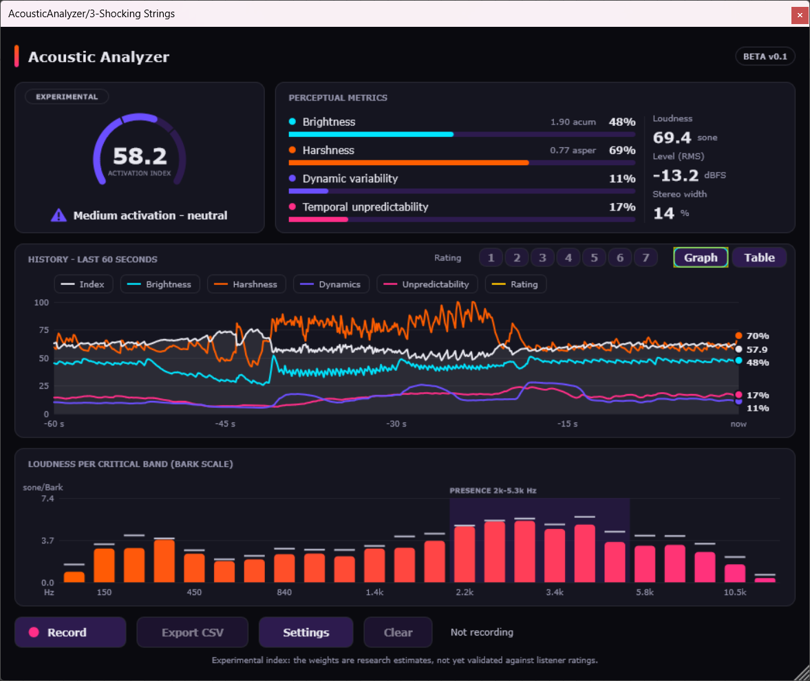
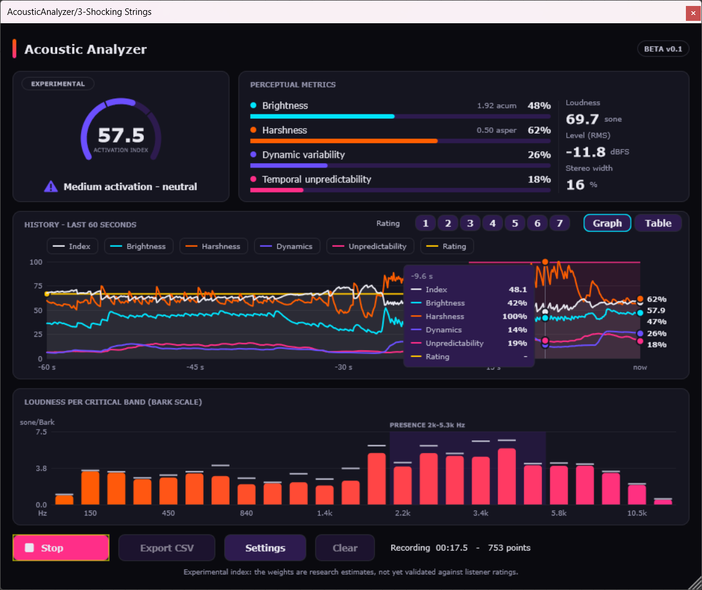
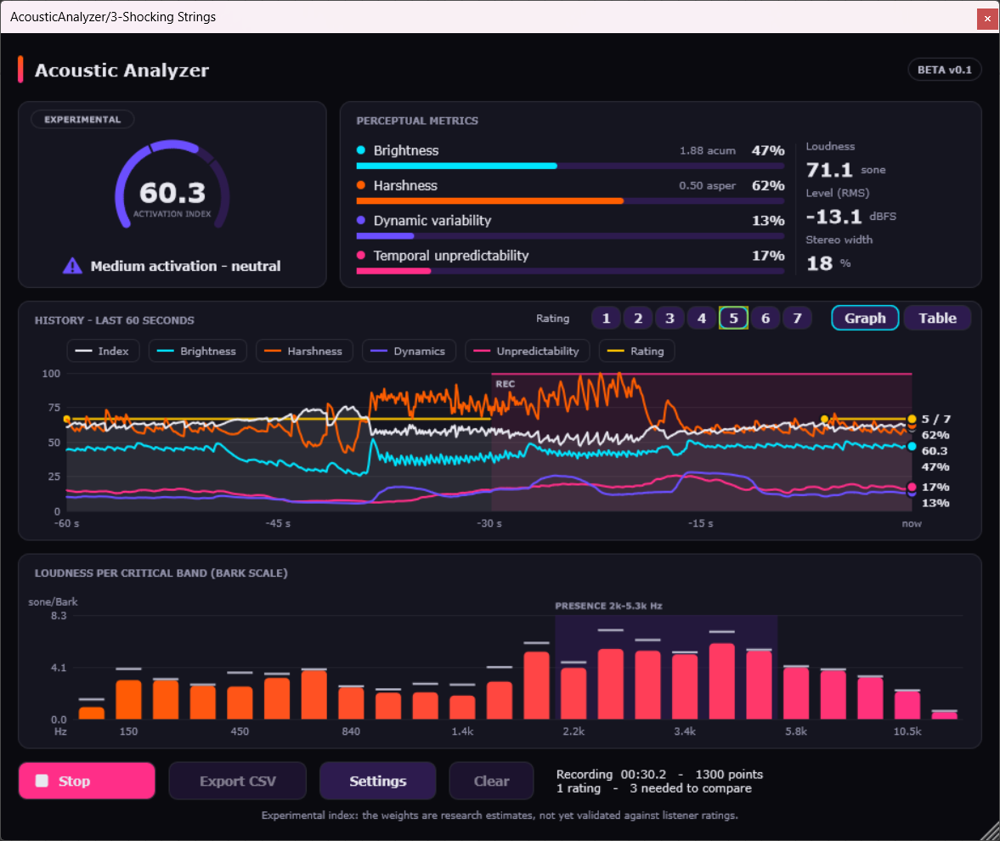
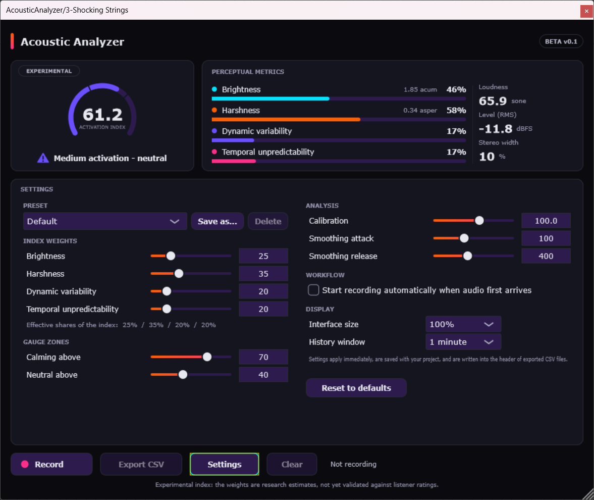

# Acoustic Analyzer

A real-time psychoacoustic analysis plugin (VST3, AU and Standalone) built with JUCE. It listens to the
audio passing through it, estimates how **calming or stimulating** the sound is, and lets you record,
rate and export the results for research.

The audio is never changed. It is a meter, not an effect: put it on any track or on the master.

> **Experimental research tool.** The underlying measures are checked against reference software (see
> [Accuracy](#accuracy)), but the Activation Index has not yet been validated against listener outcomes.
> It is not a medical or clinical device and does not measure the brain.



## Download and install

Free beta builds are on the [GitHub Releases page](https://github.com/Code4Al1z/AcousticAnalyzer/releases).
Each release lists a checksum for every file.

- **Windows:** copy the `AcousticAnalyzer.vst3` folder to `C:\Program Files\Common Files\VST3\`, then
  rescan plugins in your DAW. The build is not code-signed, so Windows SmartScreen may show a warning:
  choose **More info**, then **Run anyway**.
- **macOS:** copy the `.vst3` to `/Library/Audio/Plug-Ins/VST3/` and the `.component` (AU) to
  `~/Library/Audio/Plug-Ins/Components/`, then rescan. The Mac build is signed and notarised.
- **Standalone:** `AcousticAnalyzer.exe` / `AcousticAnalyzer.app` runs without a DAW.

In Ableton Live, enable the VST3 system folders under Preferences, Plug-ins, then rescan. The plugin
analyses whatever is playing at its position in the track's device chain.

## What it measures

Every analysis step uses the last 2048 samples (50% overlap).

| Metric | What it means | Based on |
|---|---|---|
| **Loudness** (sone) | How loud it feels, not just the level | Zwicker loudness on 24 Bark bands |
| **Brightness** | Where the spectral weight sits | Sharpness (von Bismarck / Zwicker, acum) |
| **Harshness** | Rough, rasping or piercing content | Roughness (simplified Daniel & Weber) plus loudness at 2 to 5.3 kHz |
| **Dynamic variability** | How much the level moves over 5 s | Spread of 50 ms RMS levels |
| **Temporal unpredictability** | How abrupt the level changes are | Jump size between 50 ms windows |
| **Stereo width** | 0 mono, 0.5 unrelated, 1 opposite polarity | Side / (mid + side) energy |
| **Level** (dBFS) | Plain RMS level | RMS |

### Acoustic Activation Index (0 to 100)

The gauge shows a weighted average of `(1 - metric) x 100` over brightness, harshness, dynamic
variability and temporal unpredictability. **High means calming, low means stimulating.** The default
weights are 25 / 35 / 20 / 20 and can be changed in Settings. Loudness, level and stereo width are
shown but are not part of the index.

By default an index above 70 shows **Low activation - calming**, above 40 **Medium activation - neutral**,
and 40 or below **High activation - stimulating**. Each zone has its own colour, icon and label.
At digital silence the gauge shows *No signal* and holds its values.

## The interface

| Area | What you see |
|---|---|
| **Gauge** | The index as an arc and a number, with the zone label and icon |
| **Metric panel** | Bars for brightness, harshness, dynamics and unpredictability, plus loudness, level and stereo width |
| **History** | A graph or a table of the recent past, switched with **Graph / Table**; the rating strip sits here |
| **Bark spectrum** | Specific loudness in 24 critical bands, with peak hold and the 2 to 5.3 kHz presence region marked |
| **Footer** | Record, Export, Settings, Clear, a status line and a **Report a bug** link |

The window resizes from 820 x 700 to 1800 x 1300 and the size is saved with the project.

### History graph



- Six series: index, brightness, harshness, dynamics, unpredictability and the listener rating.
- Click a legend chip to hide or show a series. Hover for exact values.
- Shaded spans mark recording; dots mark ratings.
- The window shows 30 s, 1 min or 5 min.

## Recording, rating and exporting

1. Press **Record**, or enable *Auto-record* in Settings.
2. While recording, rate how calming the sound feels right now with the rating strip or keys **1 to 7**
   (1 = not at all, 7 = very calming).
3. Press **Record** again to stop, then **Export**.



Recording uses a lock-free buffer, so it never blocks the audio thread. The log is held in memory and is
not saved with the project, so **export before closing**.

| Format | Use |
|---|---|
| `.csv` | Spreadsheets, R, Python. Starts with `#` lines holding the settings, calibration, plugin version and ratings summary |
| `.json` | Scripts and web tools, same columns |
| `.txt` | Rating events only, as an Audacity label track |

With at least three ratings, the status line shows **rho**: the Spearman rank correlation between your
ratings and the plugin's mean index over the 5 s before each rating.

### Analysing a study

```bash
python tools/analyze_ratings.py session1.csv session2.csv
```

This reports each metric's correlation with the ratings, the index's own correlation, and suggested
weights with bootstrap 90% intervals. It refuses to fit with fewer than 10 ratings. Treat the suggested
weights as a starting point for the next study, not as a result.

## Settings

Click **Settings** in the footer. Nothing here changes the audio. Settings are saved with the DAW
project, written into every export, and are not host-automatable.



| Setting | Default | What it affects |
|---|---|---|
| **Preset** | Default | Sets all four weights at once. Built-ins: Default, Equal weights, Spectral only, Temporal only. You can save your own |
| **Weights** | 25 / 35 / 20 / 20 | The gauge number, index line, exports and rating comparison. Not the four metric bars. Only the ratios matter; all zero means equal |
| **Calm above / Neutral above** | 70 / 40 | The gauge's label, icon and colour only |
| **Calibration** | 100 dB SPL at 0 dBFS | Loudness, roughness audibility and harshness, so the index. Not level, stereo width or the dynamics metrics |
| **Smoothing attack / release** | 100 / 400 ms | How steady the displays and logged values are |
| **Auto-record** | Off | Starts a recording when sound begins and stops it after silence |
| **Interface size** | 100% | Window scale: 100, 125 or 150% |
| **History window** | 1 min | Graph only, not the log |
| **Reset to defaults** | | Resets these settings; leaves the log and window size alone |

**Calibration:** the model needs to know how loud your system plays. If a full-scale sine reads about
100 dB SPL, keep the default. For quieter monitoring, measure it and enter the value. With headphones,
treat loudness as relative rather than absolute.

**Presets** are small XML files you can copy to share:

- Windows: `%APPDATA%\TrailblaiZ\AcousticAnalyzer\Presets`
- macOS: `~/Library/Application Support/TrailblaiZ/AcousticAnalyzer/Presets`
- Linux: `~/.config/TrailblaiZ/AcousticAnalyzer/Presets`

## Keyboard shortcuts

| Key | Action |
|---|---|
| **1 to 7** (also number pad) | Submit a rating while recording |
| **Tab / Shift+Tab** | Move focus; every control has a visible focus outline |
| **Space / Enter** | Activate the focused button or legend chip |

Some DAWs capture keys before plugins see them. If 1 to 7 do nothing, click inside the plugin first or
use the rating buttons.

## Reporting a bug

Click **Report a bug** in the bottom-right corner. You can open a draft GitHub issue, open a draft email,
or copy the details to paste anywhere. The plugin sends nothing itself: you review the draft first.

The details contain only the plugin version and format, host, operating system, sample rate, block size,
channels, and your settings. They never include your name, file paths, project names or audio.

## Accuracy

The measures were checked against [MoSQITo](https://github.com/Eomys/MoSQITo) 1.2.1 (ISO 532-1
loudness, DIN 45692 sharpness, Daniel & Weber roughness) on 57 calibrated test signals at 48 kHz.

| Metric | Median ratio to reference | Within 20% | Rank correlation | Known limit |
|---|---|---|---|---|
| Sharpness | 0.95 | 100% | 0.97 | none significant |
| Loudness | 1.00 | 64% (86% within 35%) | 0.99 | about 1.5 to 2 times high on broadband noise and 2 kHz tones; low near 250 Hz |
| Roughness (reference above 0.1 asper) | 1.09 | 58% (67% within 35%) | 0.96 | about 3 times high on broadband noise modulated at 70 Hz |

The plugin ranks sounds well but its absolute values are approximate. Only synthetic signals were used
for validation. To re-run it, see `tools/validation/README.md`.

## Building from source

Requirements: CMake 3.22 or newer, a C++17 compiler (MSVC 2022, Xcode, GCC or Clang), and on Linux the
usual JUCE development packages. JUCE 8.0.8 is downloaded automatically if `modules/JUCE` is missing.

```bash
cmake -B build -DCMAKE_BUILD_TYPE=Release
cmake --build build --config Release
```

On Windows with Visual Studio, add `-G "Visual Studio 17 2022"` to the first command. The VST3 is built
to `build/AcousticAnalyzer_artefacts/Release/VST3/` and the standalone app to `.../Standalone/`; copy the
VST3 to your VST3 folder yourself.

| CMake option | Default | Effect |
|---|---|---|
| `ACOUSTIC_JUCE_TAG` | `8.0.8` | JUCE version used by the automatic download |
| `ACOUSTIC_BUILD_VALIDATION` | `OFF` | Also builds the validation harness |
| `AAX_SDK_PATH` | unset | Adds an AAX build (needs Avid's SDK) |

```
CMakeLists.txt          build, JUCE download, formats
src/                    PluginProcessor (DSP, metrics, log), PluginEditor, LogExporter, Presets,
                        Parameters.h (IDs stored in projects: never rename), ui/ (components)
tools/analyze_ratings.py   study analysis
tools/validation/       MoSQITo comparison pipeline and C++ harness
scripts/                packaging and release scripts
docs/                   release notes and README images
```

## Credits and licence

Built with [JUCE](https://juce.com) 8. Validated against [MoSQITo](https://github.com/Eomys/MoSQITo).
Colour palette by TrailblaiZ.

See the `LICENSE` file. JUCE is dual-licensed (AGPLv3 or a commercial licence), which applies to anything
you distribute that is built with it.
